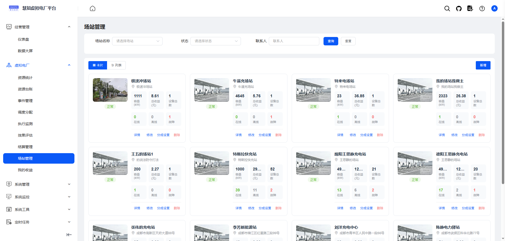
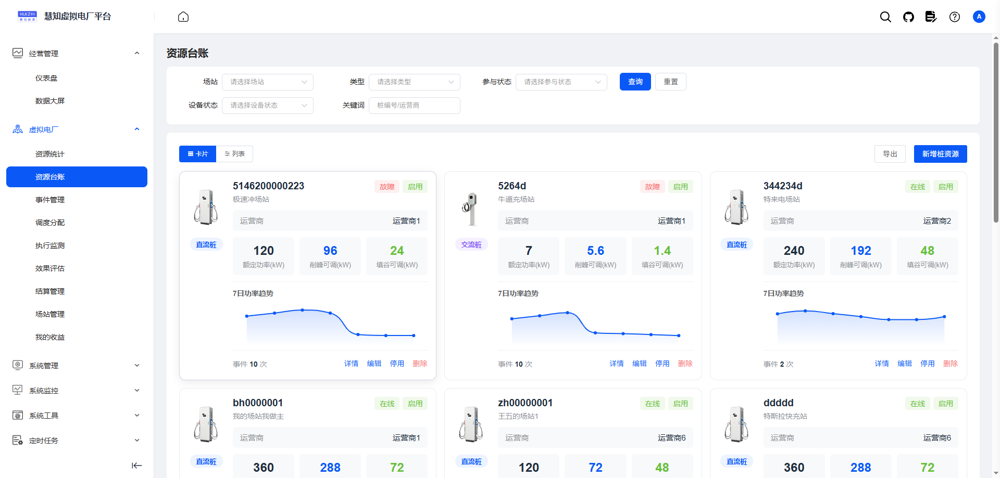
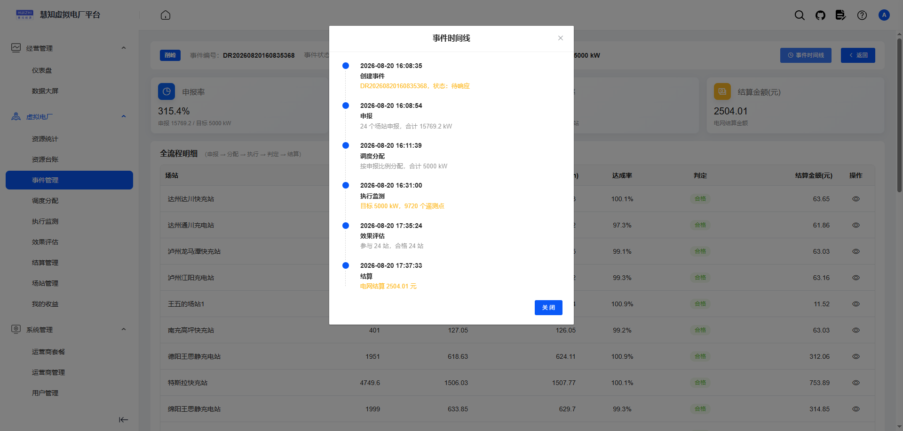
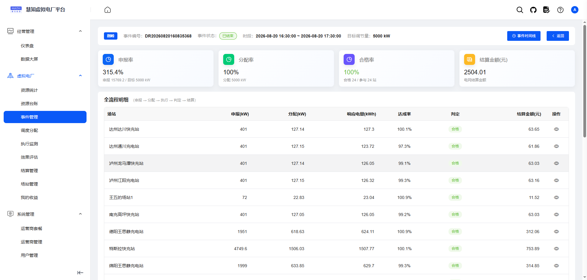
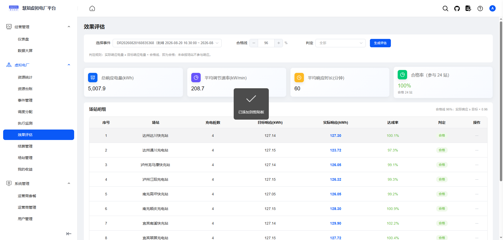

# VPP 虚拟电厂管理平台（前端）

> 基于 Vue 2 + Element UI 的虚拟电厂（Virtual Power Plant）管理平台前端，覆盖资源管理、事件申报、调度分配、执行监测、效果评估、结算分账全流程页面。

## 演示环境

- 地址：https://vpp-pc.huizhidata.com
- 账号 / 密码：`xndc` / `admin123`
- 目前演示地址权限全开,请勿随意删除相关数据,本人只做了初始化数据库备份,如果出现异常情况,会选择直接回滚初始版本

## 项目地址

- 后端：https://github.com/roinli/govpp-cloud
- 前端：https://github.com/roinli/govpp-admin（当前）

## 文档地址

- https://vpp-doc.huizhidata.com

## 个人博客

- https://wenhui.huizhidata.com

## 技术栈

| 组件 | 版本 | 说明 |
|---|---|---|
| Vue | 2.6.12 | 前端框架 |
| Element UI | 2.15.14 | UI 组件库 |
| ECharts | 5.4.0 | 图表可视化 |
| Vue Router | 3.4.9 | 路由管理 |
| Vuex | 3.6.0 | 状态管理 |
| Axios | 0.24.0 | HTTP 请求 |
| Sass | 1.32.13 | CSS 预处理器 |
| Vue CLI | 4.4.6 | 构建工具 |

## 页面模块

```
src/views/
├── vpp/
│   ├── station/          // 场站管理
│   ├── resource/         // 资源管理（充电桩台账）
│   ├── event/            // 事件管理（需求响应事件）
│   ├── event-detail/     // 事件详情（申报 + 分配 + 曲线 + 评估）
│   ├── dispatch/         // 调度分配
│   ├── execute/          // 执行监测（目标 vs 实际曲线对比）
│   └── assess/           // 效果评估（基线、响应电量、合格判定）
├── system/               // 系统管理（用户/角色/菜单/字典/租户等）
├── monitor/              // 服务监控
├── job/                  // 定时任务
└── components/           // 公共组件
```

## 开发

```bash
# 安装依赖
npm install

# 启动开发服务
npm run dev
```

浏览器访问 http://localhost:80

## 发布

```bash
# 构建测试环境
npm run build:stage

# 构建生产环境
npm run build:prod
```

## 环境变量

| 文件 | 说明 |
|---|---|
| `.env.development` | 开发环境配置 |
| `.env.staging` | 测试环境配置 |
| `.env.production` | 生产环境配置 |

主要配置项：
- `VUE_APP_BASE_API`：后端 API 地址
- `VUE_APP_AMAP_KEY`：高德地图 Key（场站地图定位）

## 功能截图















