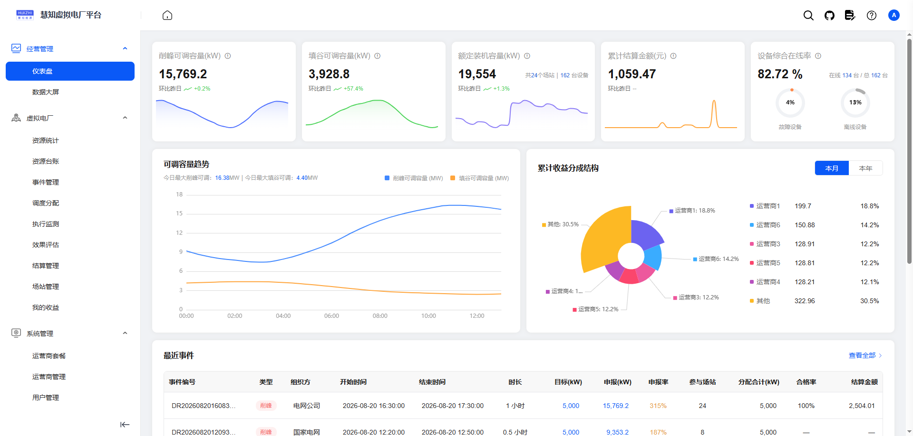
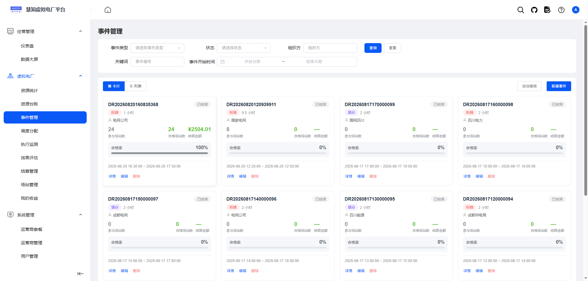
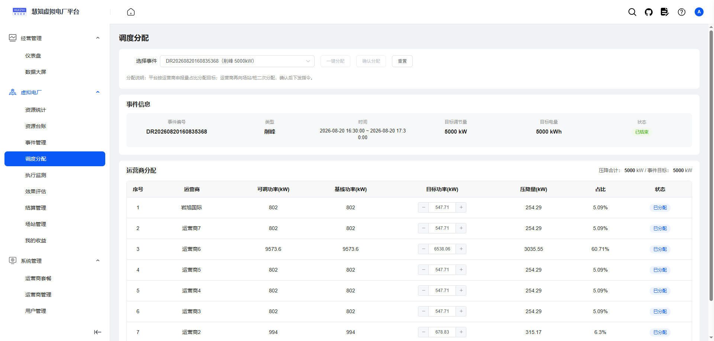
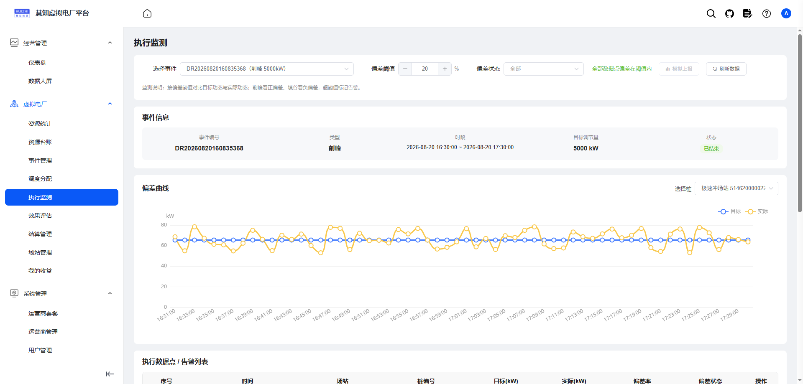
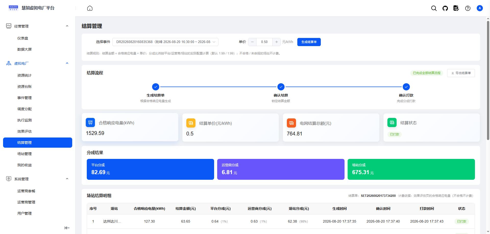
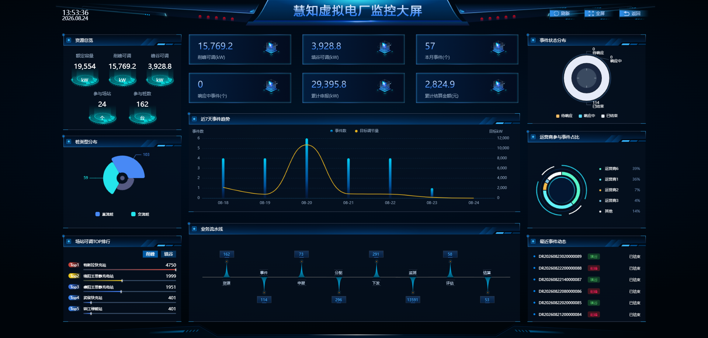

# 慧知虚拟电厂管理平台（前端）

当前版本：1.2.2

[🔥 慧知虚拟电厂管理平台前端源码](https://github.com/roinli/govpp-admin)（当前）

[🔥 慧知虚拟电厂平台后端源码](https://github.com/roinli/govpp-cloud)

[🔥 个人博客](https://wenhui.huizhidata.com)

> 基于 Vue 2 + Element UI + ECharts 的虚拟电厂（Virtual Power Plant）管理平台前端，覆盖资源管理、事件申报、调度分配、执行监测、效果评估、结算分账全流程页面。

<p align="center">
    <a href="https://vpp-pc.huizhidata.com">在线体验</a> | <a href="https://vpp-doc.huizhidata.com/">帮助文档</a>
</p>

<p align="center">
    
    
    
    
</p>

⚡️慧知开源虚拟电厂（VPP）平台前端源码⚡️；⚡️VPP 慧知虚拟电厂运营后台⚡️；Vue 2 + Element UI + ECharts，多租户、多级分账、削峰填谷、智能调度、执行监测、效果评估、数据大屏，一站式虚拟电厂解决方案。

本平台基于 MIT 协议发布，代码全开源无加密、可免费商用，适合充电运营商、聚合商与需求响应服务商，快速构建充电桩需求响应与虚拟电厂运营平台。

---

## 📖 项目介绍

系统采用 Vue 2 + Element UI + ECharts 前后端分离架构，配套 [govpp-cloud](https://github.com/roinli/govpp-cloud) 微服务后端。覆盖首页驾驶舱、聚合总览、资源台账、事件管理、事件申报、调度分配、执行监测、效果评估、结算管理与数据大屏全流程页面，围绕「资源管理 → 事件申报 → 调度分配 → 执行监测 → 效果评估 → 结算分账」实现充电桩需求响应的可视化运营；原生多租户隔离，支持多个运营商与场站独立运营，权限精确到按钮。








---

## 系统演示

在线演示：https://vpp-pc.huizhidata.com（账号：`xndc` / 密码：`admin123`）

演示环境权限开放，请勿随意删除数据。本地启动体验见下方「快速开始」。

---

## 📚 项目资料

- 在线文档：https://vpp-doc.huizhidata.com/  （使用文档 / 接口文档）
- 环境变量：`.env.development` / `.env.staging` / `.env.production` 分别对应开发、测试、生产环境。
- 主要配置项：
  - `VUE_APP_BASE_API`：后端 API 地址
  - `VUE_APP_AMAP_KEY`：高德地图 Key（场站地图定位）

---

## 核心功能

#### 首页驾驶舱与数据大屏
首页驾驶舱聚合资源、场站、事件、收益等核心指标，统计卡 + 图表 + 快捷入口一屏掌握；数据大屏深蓝科技风三栏布局，30 秒自动刷新、一键全屏，适用于调度中心投屏展示。

#### 需求响应全流程页面
事件管理（削峰/填谷）与状态流转、场站级事件申报（申报容量 ≤ 可调容量）、事件详情一屏汇总申报/分配/执行/判定/结算，完整承载"收事件 → 申报 → 派单 → 控桩 → 监测 → 验收 → 结账"业务闭环。

#### 资源与场站管理
充电站台账、地理位置标注（高德地图）、启停控制；充电桩资源台账、额定功率与可调容量、聚合总览，支持场站 - 桩两级资源建模。

#### 智能调度分配
目标调节量按可调容量/申报容量比例一键分配，平台 → 运营商 → 场站 → 桩逐级派单、微调与人工确认，多级调度可视化。

#### 执行监测
目标曲线 vs 实际曲线实时对比，偏差超阈值自动告警，直观呈现各场站/桩的执行偏差与响应态势。

#### 效果评估
基线功率计算、响应电量统计、按场站任务目标判定合格（合格线 80%），形成可量化的响应考核结果。

#### 结算分账
响应电量 × 单价核算收益，按平台/运营商/场站比例自动分账（演示默认 8:1:1），结算单生成、确认与打款流程可视化。

#### 系统管理
用户、部门、岗位、角色、菜单、按钮权限、数据范围、字典参数、通知公告、操作/登录日志全套系统管理页面，多租户数据隔离。

#### 高效开发支持
内置代码生成前端模板、动态路由与菜单权限、公共组件（上传/分页/字典标签/地图选点等），便于快速二开。

---

## 系统优势

#### 成熟稳定的前端技术栈
Vue 2 + Element UI + ECharts + Vue CLI，组件化开发、路由懒加载，前后端分离架构清晰。

#### 完整的需求响应业务闭环
从事件、申报、分配到执行、评估、结算全流程页面贯通，申报容量约束、比例分配、偏差告警、合格判定、分账比例等业务规则均已落地可视化。

#### 多级分账可视化
平台 / 运营商 / 场站多级收益分成页面，分成比例可配置，贴合充电运营商与聚合商的实际经营模式。

#### 数据可视化
首页驾驶舱、数据大屏、目标/实际曲线对比，运营态势一屏呈现，演示效果突出。

#### 精细权限控制
基于动态路由 + 按钮级权限标识，支持租户数据隔离与数据权限范围，保障系统安全。

#### 高效开发支持
内置代码生成前端模板与公共组件，配合后端 `vpp-demo` 单体运行示例，新业务页面可快速搭建。

---

## 💻 技术特点

### 运行环境及框架

1. 前端框架 Vue 2 + Element UI + ECharts + Vue CLI（配套后端 govpp-cloud，前后端分离）
2. 运行环境 Node.js + npm，Windows / Linux / macOS 均支持
3. 开发运行需在 `.env.development` 中配置 `VUE_APP_BASE_API` 指向后端网关地址

### 前端框架版本

```
1. Vue 2.6.12
2. Element UI 2.15.14
3. ECharts 5.4.0
4. Vue Router 3.4.9
5. Vuex 3.6.0
6. Axios 0.24.0
7. Sass 1.32.13
8. Vue CLI 4.4.6
```

### 页面模块介绍

```
src/views/
├── dashboard/             // 首页驾驶舱（统计卡 + 图表 + 快捷入口）
├── vpp/
│   ├── resource/          // 资源管理（充电桩台账）
│   ├── overview/          // 聚合总览
│   ├── event/             // 事件管理（需求响应事件）
│   ├── apply/             // 事件申报
│   ├── dispatch/          // 调度分配
│   ├── execute/           // 执行监测（目标 vs 实际曲线对比）
│   ├── assess/            // 效果评估（基线、响应电量、合格判定）
│   ├── settlement/        // 结算管理（分账、结算单）
│   └── screen/            // 数据大屏
├── system/                // 系统管理（用户/角色/菜单/字典/租户等）
├── monitor/               // 服务监控
├── job/                   // 定时任务
├── tool/                  // 代码生成
└── components/            // 公共组件
```

## 快速开始

环境要求：Node.js + npm（Windows 构建脚本已内置 `NODE_OPTIONS=--openssl-legacy-provider`，Linux/macOS 若报 OpenSSL 错误请手动设置）。

1. 克隆仓库：`git clone https://github.com/roinli/govpp-admin && cd govpp-admin`
2. 安装依赖：`npm install`
3. 配置环境变量：在 `.env.development` 中设置 `VUE_APP_BASE_API` 为后端网关地址。
4. 启动开发服务：`npm run dev`，浏览器访问 http://localhost:80
5. 发布构建：
   - 测试环境：`npm run build:stage`
   - 生产环境：`npm run build:prod`

> 注意：前端需配合后端 [govpp-cloud](https://github.com/roinli/govpp-cloud) 一起启动，后端启动说明见其 README。

---

## 功能矩阵

| 🔴 需求响应页面 | 🟠 资源与调度 | 🟡 监测评估 | 🟢 结算收益 | 🔵 平台底座 | 🟣 系统设置 |
|---|---|---|---|---|---|
| 事件管理（削峰/填谷） | 场站管理 | 执行监测 | 结算管理 | 登录/鉴权 | 用户管理 |
| 事件申报 | 资源台账 | 偏差告警 | 平台/运营商/场站分成 | 首页驾驶舱 | 角色权限 |
| 事件详情 | 聚合总览 | 效果评估 | 结算单生成 | 数据大屏 | 菜单管理 |
| 状态流转 | 调度分配 | 合格判定 | 收益统计 | 动态路由 | 部门/岗位 |
| | 人工确认 | 响应电量统计 | | 按钮权限 | 数据字典 |
| | | | | 公共组件 | 通知公告 |
| | | | | | 操作/登录日志 |

## 相关文档

- [后端源码 govpp-cloud](https://github.com/roinli/govpp-cloud)
- [在线文档](https://vpp-doc.huizhidata.com/)

## 致谢

本项目基于 [RuoYi-Vue](https://gitee.com/y_project/RuoYi-Vue) 与 [witos-ui](https://github.com/roinli/HUIZHI-Witos-ui) 二次开发，感谢若依开源社区与 witos 开源作者的贡献。

## 反馈与交流

- 项目主页：https://github.com/roinli/govpp-admin
- 欢迎通过 GitHub Issues 提交 Bug、交流方案、获取更新动态。

---

© 2026 慧知 版权所有 · 开源协议：MIT License